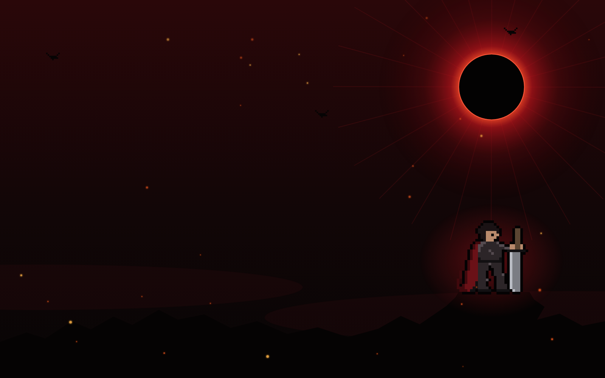
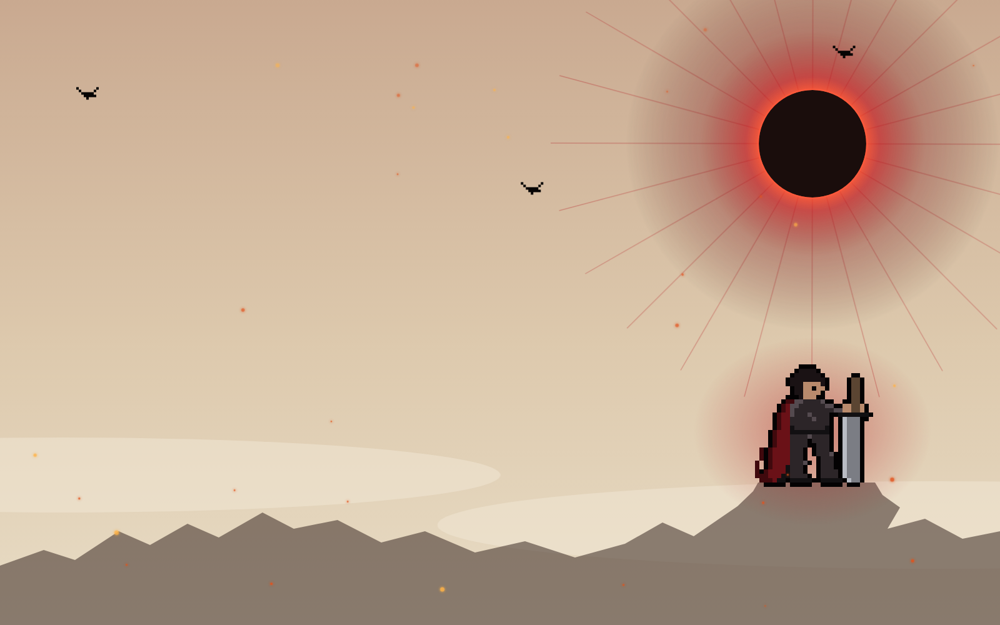

# Black Eclipse — a dark-fantasy theme for Claude

A custom theme (mod) for the **Claude desktop app**. Blood-crimson accents, iron and ash grays at night, old parchment by day, and a live animated background: a blood-red eclipse, a pixel-art swordsman standing on a crag, crows crossing the sky and embers drifting up.



<details>
<summary>Light mode</summary>



</details>

## Features

- **Full color palette** for light and dark mode, built on Claude's design-system tokens and checked for text contrast.
- **Animated SVG scene** with no images or scripts: pulsing eclipse corona, slowly turning rays, drifting mist, rising embers.
- **Pixel-art sprites** in a retro handheld-game style: a swordsman with a flapping cape and a glint that runs down his blade, plus flapping crows.
- Respects **reduced motion**: if your system turns animations off, the scene holds still.
- Adapts to tall or narrow windows so the swordsman stays on screen.

## Install

In a terminal session of Claude Code:

```
/plugin install black-eclipse --marketplace nomad1q/black-eclipse-claude-theme
```

From a shell:

```bash
claude plugin install black-eclipse --marketplace nomad1q/black-eclipse-claude-theme
```

In the desktop app: click **+** next to the prompt box → **Plugins** → **Add marketplace** with `nomad1q/black-eclipse-claude-theme` → **Add plugin**.

Pick the **user** scope so the theme loads in every session. Themes draw in local sessions of the desktop app.

## Customize

| What | Where |
| --- | --- |
| Colors (both modes) | `PALETTE` in [`hooks/register.tsx`](hooks/register.tsx) |
| How see-through the panels are | `glass` in [`hooks/register.tsx`](hooks/register.tsx) |
| Pixel sprites (swordsman, crows) | the pixel grids in [`tools/sprites.py`](tools/sprites.py) |
| Scene (eclipse, embers, ridge) | [`tools/gen_scene.py`](tools/gen_scene.py) |

After editing the sprites or scene, rebuild it:

```bash
python tools/gen_scene.py hooks/scene.ts
```

## How it works

The theme is a Claude Code hooks module. On `session.start` it calls `$.theme.set` with a generated palette and a backdrop scene, and a `ui.render` hook on `Backdrop` draws the animated SVG.

## Credits

Original artwork, inspired by the mood of dark-fantasy manga. Not affiliated with or endorsed by any series or its publishers.

## License

[MIT](LICENSE)
